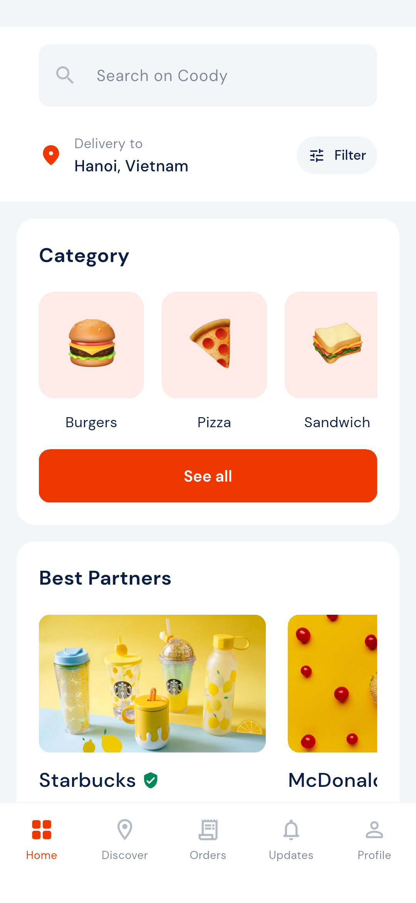
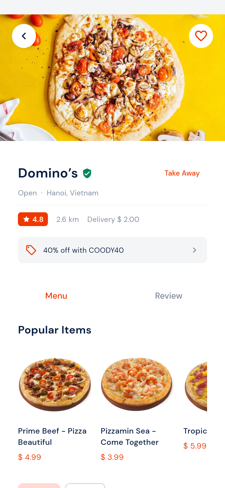
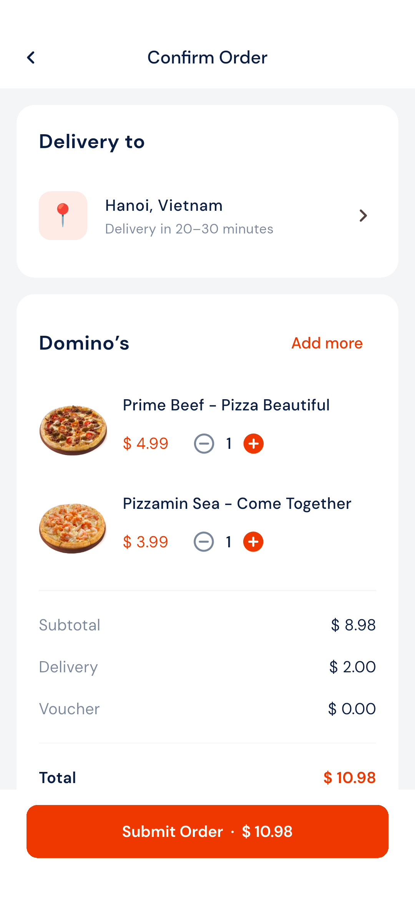
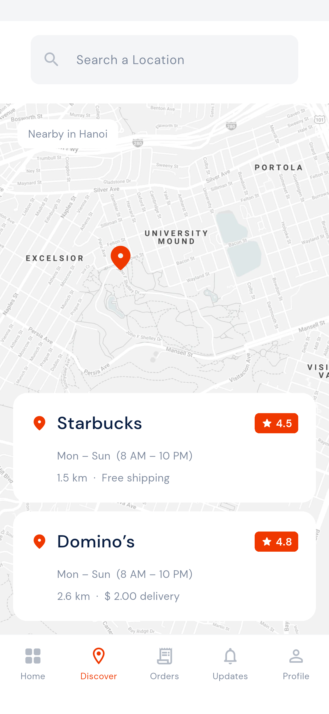
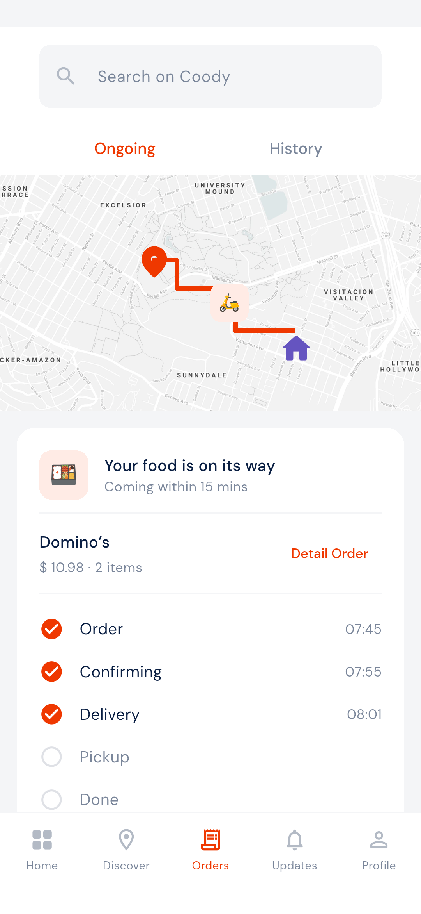
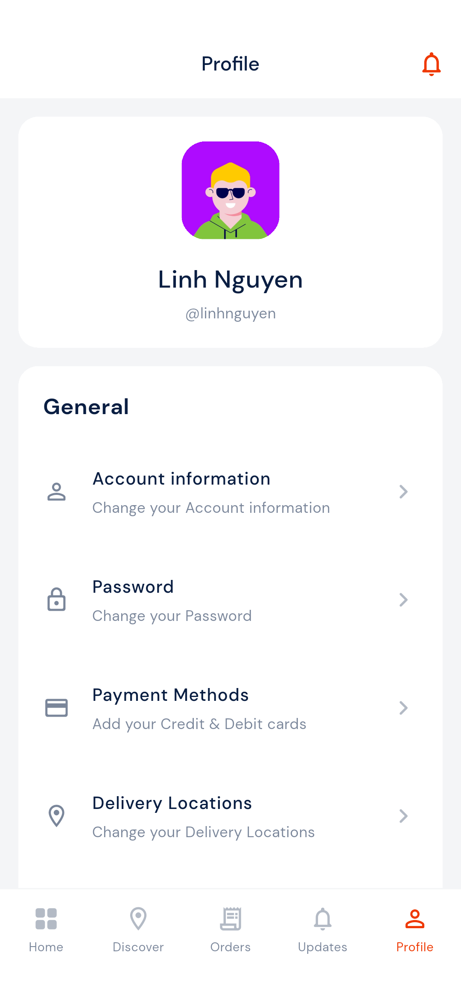
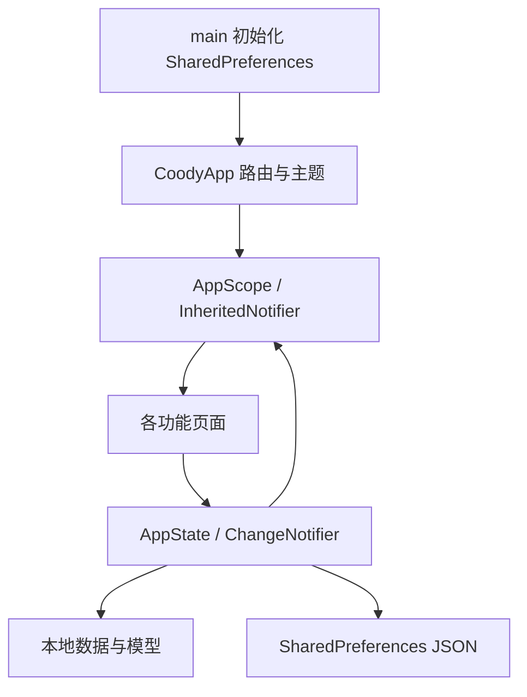

# Coody · Flutter 美食外卖 App

基于 Pixso 中 **Coody / Design** 的 54 个界面，以及 **Symbols** 组件分类实现的 Flutter 应用。支持 Android、iOS 和 Web；本次在 Windows 上完成 Android 模拟器验证。

包含引导、账号表单、位置选择、首页三个版本、分类筛选、搜索、餐厅菜单与评论、商品加料、购物车、结算、地图发现、订单进度、评价和个人设置。填充状态和不同列表版本通过共享页面参数实现，避免复制 54 套代码。

这是可交互的**本地 UI 演示应用**：没有接入后端账号、短信、支付网关、定位或配送服务。商品和地图使用原设计素材，购物车、地址、个人资料、收藏和演示订单保存在本地。

## 主要界面

以下图片为 Android 模拟器中运行 Flutter 应用的实际截图。

| 首页 | 餐厅菜单 | 结算 |
| --- | --- | --- |
|  |  |  |

| 地图发现 | 配送进度 | 个人中心 |
| --- | --- | --- |
|  |  |  |

完整的页面对应关系、截图及长页补充截图见 [界面清单](docs/界面清单.md)。截图目录保留原设计编号，原稿中重复的 `404 - Rate item` 使用 `404-item` 区分。

## 运行

环境：Flutter 3.47.7 / Dart 3.13.5，Android SDK 已配置。依赖版本由 `pubspec.lock` 固定。

```powershell
flutter pub get
flutter run -d emulator-5554
```

首次打开进入引导页，可跳过，或在登录页选择 **Explore as a guest**。本地账号表单要求邮箱格式正确、密码至少 8 位；注册填写姓名后进入地址选择。验证码为 `1234`，优惠码为 `COODY40`，可抵扣商品小计的 40%。

单独查看某一界面：

```powershell
flutter run -d emulator-5554 --dart-define=INITIAL_SCREEN=214
```

`INITIAL_SCREEN` 只指定入口，不注入截图示例状态。付款方式空/已添加、购物车空/非空和订单状态仍由实际本地数据决定。自动截图使用独立测试数据，不修改正常运行时的数据。

Web 预览：

```powershell
flutter run -d chrome
flutter build web
```

Android 安装包：

已生成的体验包位于 [dist](dist/README.md)：[Android ARM64](dist/Coody-1.0.0-arm64.apk) / [模拟器 x64](dist/Coody-1.0.0-x64.apk)。

```powershell
flutter build apk --release --split-per-abi
```

iOS 工程已生成，但需要在 macOS 上配置签名并编译；本次没有执行 iOS 构建。Android release 目前使用开发签名，仅用于体验和验收，正式分发前需替换签名。

## 项目结构

```text
CoodyFood/
├── lib/
│   ├── main.dart                 # 初始化本地存储、系统栏和应用
│   ├── app.dart                  # AppScope、主题、54 个页面状态的路由
│   ├── core/theme.dart           # 颜色、DM Sans、表单及按钮规范
│   ├── models/food.dart          # 餐厅、商品、购物车项及金额格式
│   ├── data/catalog.dart         # 本地餐厅和商品数据
│   ├── state/app_state.dart      # 购物车、资料、收藏、订单和持久化
│   ├── ui/components.dart        # 公共布局、卡片、图片、导航和数量控件
│   └── features/
│       ├── auth.dart             # 引导、登录、注册、验证码和地址
│       ├── browse.dart           # 首页、商家列表、搜索和筛选
│       ├── restaurant.dart       # 菜单、评论、商品、购物车和结算
│       ├── orders.dart           # 地图发现、订单、评价及完成状态
│       └── profile.dart          # 个人资料、付款方式、通知和邀请
├── assets/
│   ├── fonts/                    # 原设计提供的 DM Sans 字体
│   └── images/                   # 原设计照片、地图及导出的引导 SVG
├── test/
│   ├── fixtures.dart             # 独立于产品代码的截图示例状态
│   ├── state_test.dart           # 金额、合并、持久化和筛选测试
│   ├── screens_test.dart         # 375 宽布局检查
│   ├── small_screens_test.dart   # 320 宽布局检查
│   └── checkout_test.dart        # 完整点餐流程；其他文件为共享测试辅助
├── integration_test/
│   ├── screenshots_test.dart     # Android 批量截图与长页补充
│   └── order_flow_test.dart       # Android 点餐、送达及评价流程
├── tool/
│   ├── import_design.py          # 从用户提供的 Sketch 压缩包提取素材
│   ├── image-index.json          # 原稿图片引用和用途映射
│   └── screenshot_driver.dart    # 将模拟器截图写入 docs/screenshots
├── docs/
│   ├── 界面清单.md                # 设计编号 → 实现页面 → 截图
│   ├── 验证说明.md                # 验证方法、结果及实现边界
│   ├── reference/                # 设计页面清单、原稿总览、颜色资料
│   └── screenshots/              # 所有界面实际截图
├── dist/                         # release 体验安装包与安装说明
└── android/ · ios/ · web/         # Flutter 平台工程
```

## 架构与状态流

采用轻量的**按功能组织 UI + 单一应用状态**结构。没有引入复杂的状态管理框架；两个运行时依赖分别处理 SVG 原稿插画和本地持久化。



页面只负责展示和收集输入；`AppState` 统一计算商品金额、加料、数量、配送费、折扣和最终金额。金额以整数分计算，避免浮点累计误差。相同商品及相同加料合并；不同加料分行。切换商家时检查已有购物车；下单后复制订单快照，再清空购物车，订单详情和再次购买不会引用已被清空的列表。

`AppScope` 将 `ChangeNotifier` 注入页面，提交修改后刷新依赖页面并写入本地快照。表单输入、筛选面板未应用的选项、商品临时加料等短期状态保留在页面内。

购物车、当前餐厅、地址、资料、收藏、通知偏好、掩码卡片信息和当前演示订单可恢复。密码、验证码、完整卡号及 CVC 不写入本地存储。卡片只保存品牌和末四位，不代表已绑定可支付的卡。

## 设计来源与还原方式

- Pixso 文件：`Coody`；分类：`Design`（54 个顶层页面）、`Symbols`（276 个顶层组件/资源）。
- 已通过 Pixso 接口读取文件、分类、页面名称、文本和布局。当前接口返回图层隐藏、填充异常，PNG 导出为 0 字节。
- 为核对视觉，读取用户本机的 `Coody Food iOS UI Kit.zip` 中 `Coody.sketch`，使用其中的真实图像、矢量路径和字体；没有修改 Pixso 原文件。
- 保留原稿英文文案风格、橙红主色、深蓝文字、浅灰背景、圆角表单、白色内容分区和食物照片。修正了原稿中的部分英文拼写。
- 以原稿 375 宽布局为基础，使用可滚动内容和弹性布局适配窄屏。系统状态栏、图标字形、地图标注和部分间距属于 Flutter 原生适配，并非逐像素复刻。

## 验证与截图复现

```powershell
flutter analyze
flutter test --concurrency=1
flutter test integration_test/order_flow_test.dart -d emulator-5554
flutter drive --driver=tool/screenshot_driver.dart --target=integration_test/screenshots_test.dart -d emulator-5554
```

布局测试覆盖 54 个设计状态在 `375×812`、`320×640` 下的构建异常和溢出。Android 截图覆盖全部设计状态，并为首页、菜单、评论、结算和个人中心补充滚动后截图。结果及体验路径见 [验证说明](docs/验证说明.md)。

## 后续接入点

目前无远端服务调用。生产接入时可将 `data/catalog.dart` 替换为餐厅和菜单仓储，将 `AppState` 的下单、身份校验及订单恢复替换为服务调用。支付令牌、账号认证、实时地图、推送、配送状态及真实订单历史需要独立的后端或服务 SDK；本地偏好存储不应用作生产账号或订单数据库。
