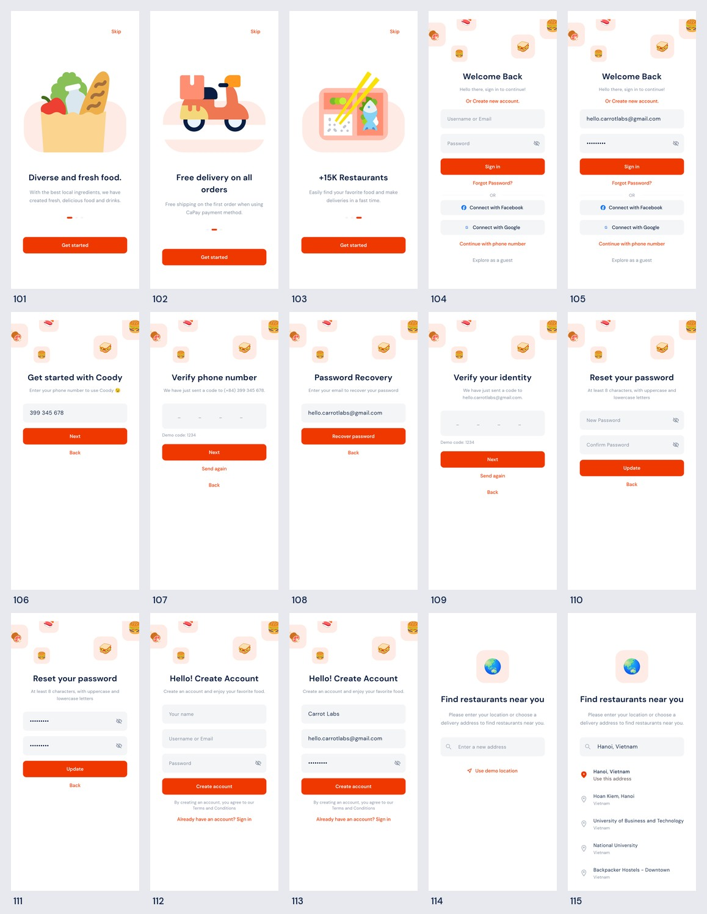
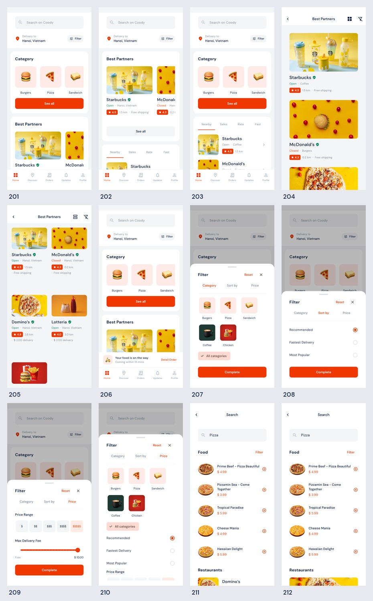
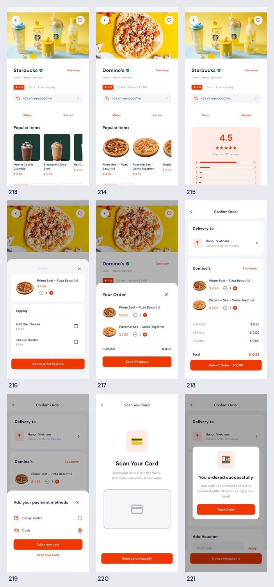
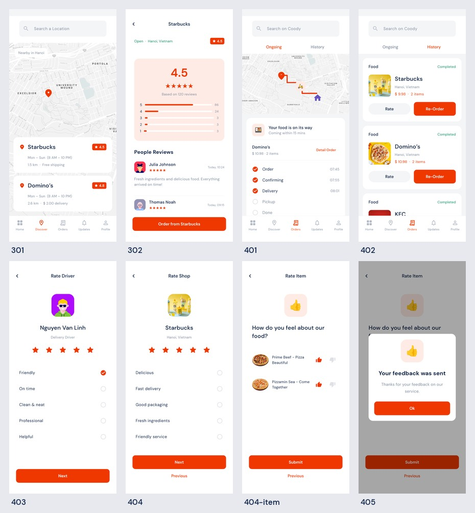
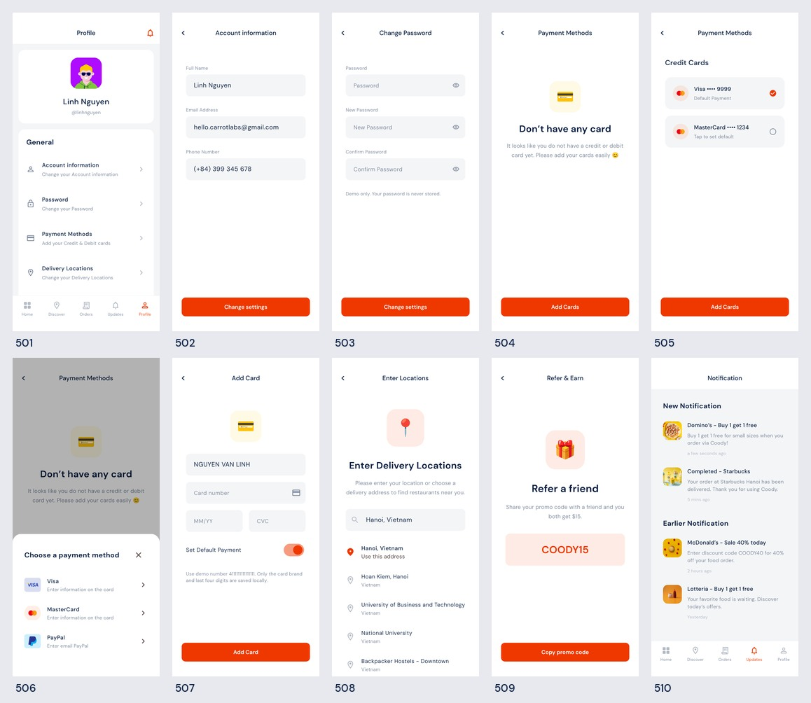

# 界面清单与实际截图

54 个设计状态全部有独立路由和 Android Flutter 渲染截图；相同业务页的空白/填充、列表版本及弹层由参数和本地状态复用。

截图为 `1080×2340`。下列链接可查看原始 PNG；每组附一张缩略总览。

## 引导与身份流程

| 路由编号 | Pixso 原页面 | 截图 |
| --- | --- | --- |
| `/101` | 101 - Onboarding | [查看 PNG](screenshots/101.png) |
| `/102` | 102 - Onboarding | [查看 PNG](screenshots/102.png) |
| `/103` | 103 - Onboarding | [查看 PNG](screenshots/103.png) |
| `/104` | 104 - Login | [查看 PNG](screenshots/104.png) |
| `/105` | 105 - Login_Filled | [查看 PNG](screenshots/105.png) |
| `/106` | 106 - Phone Number Login | [查看 PNG](screenshots/106.png) |
| `/107` | 107 - Verify phone number | [查看 PNG](screenshots/107.png) |
| `/108` | 108 - Password Recovery | [查看 PNG](screenshots/108.png) |
| `/109` | 109 - Verify your identity | [查看 PNG](screenshots/109.png) |
| `/110` | 110 - Reset your password | [查看 PNG](screenshots/110.png) |
| `/111` | 111 - Reset your password_Filled | [查看 PNG](screenshots/111.png) |
| `/112` | 112 - Register | [查看 PNG](screenshots/112.png) |
| `/113` | 113 - Register_Filled | [查看 PNG](screenshots/113.png) |
| `/114` | 114 - Enter Address | [查看 PNG](screenshots/114.png) |
| `/115` | 115 - Enter Address_Filled | [查看 PNG](screenshots/115.png) |

## 首页、列表、筛选与搜索

| 路由编号 | Pixso 原页面 | 截图 |
| --- | --- | --- |
| `/201` | 201 - Home_V1 | [查看 PNG](screenshots/201.png) |
| `/202` | 202 - Home_V2 | [查看 PNG](screenshots/202.png) |
| `/203` | 203 - Home_V3 | [查看 PNG](screenshots/203.png) |
| `/204` | 204 - Best Partners_V1 | [查看 PNG](screenshots/204.png) |
| `/205` | 205 - Best Partners_V2 | [查看 PNG](screenshots/205.png) |
| `/206` | 206 - Home_Mini Shipping | [查看 PNG](screenshots/206.png) |
| `/207` | 207 - Filter_Category | [查看 PNG](screenshots/207.png) |
| `/208` | 208 - Filter_Sort by | [查看 PNG](screenshots/208.png) |
| `/209` | 209 - Filter_Price | [查看 PNG](screenshots/209.png) |
| `/210` | 210 - Filter_All | [查看 PNG](screenshots/210.png) |
| `/211` | 211 - Search_V1 | [查看 PNG](screenshots/211.png) |
| `/212` | 212 - Search_V2 | [查看 PNG](screenshots/212.png) |

## 餐厅、点餐与结算

| 路由编号 | Pixso 原页面 | 截图 |
| --- | --- | --- |
| `/213` | 213 - Detail Restaurants_V1 | [查看 PNG](screenshots/213.png) |
| `/214` | 214 - Detail Restaurants_V2 | [查看 PNG](screenshots/214.png) |
| `/215` | 215 - Detail Restaurants_Review | [查看 PNG](screenshots/215.png) |
| `/216` | 216 - Add New Item | [查看 PNG](screenshots/216.png) |
| `/217` | 217 - Mini Card | [查看 PNG](screenshots/217.png) |
| `/218` | 218 - Add New Item | [查看 PNG](screenshots/218.png) |
| `/219` | 219 - Add your payment methods | [查看 PNG](screenshots/219.png) |
| `/220` | 220 - Scan Your Card | [查看 PNG](screenshots/220.png) |
| `/221` | 221 - Confirmation order | [查看 PNG](screenshots/221.png) |

## 发现、订单与评价

| 路由编号 | Pixso 原页面 | 截图 |
| --- | --- | --- |
| `/301` | 301 - Discover | [查看 PNG](screenshots/301.png) |
| `/302` | 302 - Discover_Detail | [查看 PNG](screenshots/302.png) |
| `/401` | 401 - Your Orders_Ongoing | [查看 PNG](screenshots/401.png) |
| `/402` | 402 - Your Orders_History | [查看 PNG](screenshots/402.png) |
| `/403` | 403 - Rate Drive | [查看 PNG](screenshots/403.png) |
| `/404` | 404 - Rate shop | [查看 PNG](screenshots/404.png) |
| `/404-item` | 404 - Rate item | [查看 PNG](screenshots/404-item.png) |
| `/405` | 405 - Feedback success | [查看 PNG](screenshots/405.png) |

## 个人中心与设置

| 路由编号 | Pixso 原页面 | 截图 |
| --- | --- | --- |
| `/501` | 501 - Profile | [查看 PNG](screenshots/501.png) |
| `/502` | 502 - Account information | [查看 PNG](screenshots/502.png) |
| `/503` | 503 - Change Password | [查看 PNG](screenshots/503.png) |
| `/504` | 504 - Payment Methods | [查看 PNG](screenshots/504.png) |
| `/505` | 505 - Payment Methods_Card | [查看 PNG](screenshots/505.png) |
| `/506` | 506 - Card list | [查看 PNG](screenshots/506.png) |
| `/507` | 507 - Add card | [查看 PNG](screenshots/507.png) |
| `/508` | 508 - Enter Locations | [查看 PNG](screenshots/508.png) |
| `/509` | 509 - Refer & Earn | [查看 PNG](screenshots/509.png) |
| `/510` | 510 - Notification | [查看 PNG](screenshots/510.png) |

## 长页补充

主要长页面同时提供滚动后截图；与首屏配合检查菜单、结算及设置等内容。

| 页面 | 滚动后截图 |
| --- | --- |
| 首页商家列表 | [查看 PNG](screenshots/201-bottom.png) |
| 咖啡餐厅完整菜单 | [查看 PNG](screenshots/213-bottom.png) |
| 披萨餐厅完整菜单 | [查看 PNG](screenshots/214-bottom.png) |
| 评论列表 | [查看 PNG](screenshots/215-bottom.png) |
| 优惠码、备注及支付方式 | [查看 PNG](screenshots/218-bottom.png) |
| 通知偏好及退出 | [查看 PNG](screenshots/501-bottom.png) |

## 状态说明

- `101–103` 为三张独立引导，`104/105`、`110/111`、`112/113` 复用表单并指定是否预填。
- `201–203` 是同一首页数据的不同布局，`204/205` 为列表/网格，`206` 为带配送摘要的首页。
- `207–209` 指定筛选标签，`210` 展示全部筛选项；选项会实际影响商家列表。
- `213/214` 分别显示咖啡/披萨餐厅，`215` 打开评论；`216/217/219/221` 为商品、购物车、付款方式和成功弹层。
- `401` 使用配送中示例状态；首次正常运行没有订单时会显示空状态。`402` 中的设计历史卡片是演示数据。
- `403 → 404 → 404-item → 405` 为配送员、店铺、商品评价和成功反馈流程；原稿两个 `404` 已分开命名。
- `504/505` 使用同一个付款方式组件，分别注入无卡和已添加掩码卡片的示例；`506` 为选择卡种弹层，`507` 为添加表单。
- 测试数据在 `test/fixtures.dart` 中，与产品业务代码及真实本地数据隔离。
